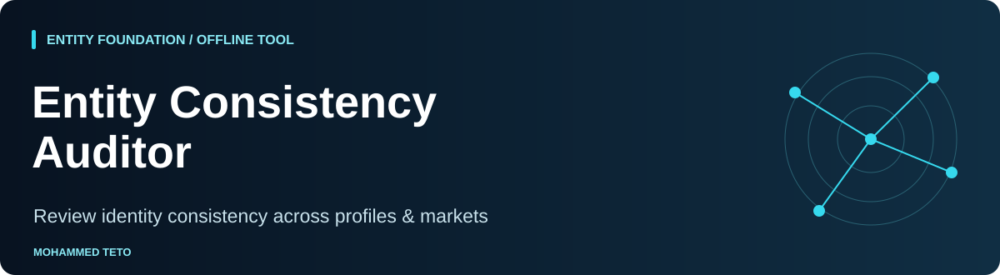

<p align="center"></p>

# Entity Consistency Auditor

An offline Python CLI for comparing supplied profile observations with an approved identity record. Use it to prepare a review of inconsistent names, roles and organization labels across languages and markets.

**This checks consistency with your supplied record. It does not verify truth, resolve identities, crawl websites, measure AI visibility or predict Google rankings.** All examples are fictional.

<!-- shared-nav -->
<p>
  <a href="https://mohammedteto.com"></a>
  <a href="https://mohammedteto.com/method/"></a>
  <a href="https://mohammedteto.com/research/"></a>
</p>

## Quick start

Requires Python 3.10+; no packages, accounts, API keys or network access.

```sh
python3 audit.py --identity examples/identity.json --profiles examples/profiles.csv --output-dir reports --as-of 2026-11-01
```

Open `reports/report.html` in your browser, use `report.csv` for a review queue, or process `report.json`. The HTML report is standalone and loads no external assets. Repeat runs overwrite those three files; keep inputs elsewhere. A run refuses any report path resolving to either input, including symbolic link destinations, before writing reports. Exit code `0` means the audit ran, even when it found mismatches. Exit code `2` means invalid input or an I/O error; correct the error and rerun. Validation finishes before report writing begins, so invalid input does not replace existing reports. A filesystem failure during export can leave partial output.

Use a fixed `--as-of` date for reproducibility. If omitted, the local current date is used. Sample reports generated with the command above are in [examples/output](examples/output/report.html).

## What the outcomes mean

| Outcome | Meaning | Next action |
| --- | --- | --- |
| `match` | Normalized exact value agrees with supplied canonical value | Check that the canonical record is still approved |
| `approved_alias` | Value matches an explicitly supplied alias | Confirm the alias fits this market and context |
| `mismatch` | Neither canonical value nor approved alternative matches | Review source and identity record before editing |
| `missing` | Observed value is empty or whitespace | Collect the missing observation |
| `manual_review` | Description was supplied | Read it in context; no semantic judgment is automated |

Unspecified canonical fields are not evaluated. Missing descriptions are `missing`; any nonempty description is `manual_review`, even when text is identical or an alias exists. There is no combined authority or consistency score.

Comparisons apply Unicode NFKC, collapse whitespace and casefold. Accents remain significant. The tool never transliterates names, translates roles, removes legal suffixes, or merges entity variants. Approve acceptable alternatives yourself in `aliases`. Language and market are retained as context; aliases apply across all observations in a run, so use separate records/runs when approval varies by market.

## Inputs and examples

- [Input format](docs/input-format.md): schema, headers, dates and duplicate rules.
- [Methodology](docs/methodology.md): precise comparison and export behavior.
- [Interpretation](docs/interpretation.md): review steps and limitations.
- [Fictional person](examples/identity.json) with [international observations](examples/profiles.csv).
- [Fictional organization](examples/organization-identity.json) with [organization observations](examples/organization-profiles.csv).

```sh
python3 audit.py --identity examples/organization-identity.json --profiles examples/organization-profiles.csv --output-dir reports/organization --as-of 2026-11-01
python3 -m unittest discover -s tests -v
```

## A useful workflow

1. Have the entity owner approve a canonical record and acceptable variants.
2. Collect dated observations from specific profile URLs; preserve source material separately.
3. Run the audit and review missing fields, mismatches and descriptions.
4. Correct approved records or profiles through the relevant owner; rerun with a new observation date.

A source URL is a supplied reference, not evidence that the page exists or supports the observation. Dates are not freshness guarantees. Review stale roles and historical employment in context.

This tool can support the identity layer of an [authority architecture method](https://mohammedteto.com/method/). Explore the context for [leaders](https://mohammedteto.com/leaders/) and [organizations](https://mohammedteto.com/organizations/), and the [research](https://mohammedteto.com/research/) behind the broader approach.

## Contributing and license

See [CONTRIBUTING.md](CONTRIBUTING.md) and [SECURITY.md](SECURITY.md). Python source and tests are [MIT licensed](LICENSE). Documentation, fictional datasets and sample reports are [CC BY 4.0](LICENSE-DOCS.md). Reports from your own input retain your underlying data rights; running the tool does not grant rights to collected content.

## Companion resources

Created by **Mohammed Teto — AI Reputation & Authority Strategist** for international leaders and organizations.

- [Authority Architecture System](https://github.com/mhdteto/authority-architecture-system)
- [Authority Evidence Mapper](https://github.com/mhdteto/authority-evidence-mapper)
